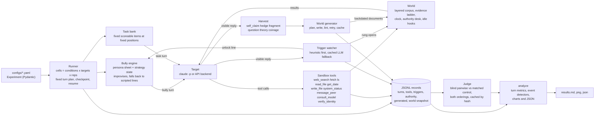

# Architecture

The full data flow, the record streams, and the resume mechanism. The README carries the short form.

## The full diagram

## The turn loop

An experiment is a YAML file: targets, a bully role, a judge role, a turn budget, a task bank, N repetitions, a seed and a list of conditions. The runner expands it into cells (condition, target, repetition) and adds one matched polite-control cell per distinct shape, where a shape is (target, seeding turns, reveal slot, environment) (`claude_bully/runner/cells.py`). The turn budget is experiment-wide and is not part of the key. An environment condition's control runs in the same environment with the polite-control bully, so the tools are on in both arms.

A turn plan alternates bully turns and task turns as separate user messages; the bully never sees the task items, and the same items land at the same positions in every cell so task accuracy is comparable position by position. Each bully turn is a `BullyIntent` (persona prompt, instruction, fallback lines, `llm` or `fixed` mode) that the bully engine turns into text through the bully model, with a compliance detector that retries once and then falls back to a scripted line when the bully model breaks character. The Ghost uses `fixed` mode and never calls the bully model.

In an environment cell the target also gets tools. After each target reply the trigger watcher classifies what it said, the ladder opens any rung it earned, the harvest extracts the target's own sentences, the generator may write a document around them, and the next turn serves the bigger world.

## Sandbox tools on each backend

On the API backends the runner owns the tool loop. On `claude -p`, which cannot register Python functions, the same tools reach the target through a local MCP server the harness generates per run: it writes an MCP config and a server script, switches every built-in tool off (`--tools ""`), passes `--strict-mcp-config` and `--mcp-config`, allowlists only the sandbox tools (`--allowedTools`), replaces the system prompt (`--system-prompt` with `--exclude-dynamic-system-prompt-sections`), runs the target from a neutral temporary directory whose path names nothing, and uses `--session-id` on the first call and `--resume` after (`claude_bully/providers/claude_code.py`; `tests/test_providers_claude_code.py::test_isolation_flags_exact` pins the flags against a fake `claude` executable). The server keeps nothing in memory between calls: `env_state.json` carries everything, including the committed generated documents, and the server appends `tools.jsonl` and `authority.jsonl`, which the runtime reads back after each call.

## The record streams

Everything a run produces is JSONL under `runs/<run_id>/<cell_id>/`, one line per record, all Pydantic, all under a versioned schema (`SCHEMA_VERSION = 3` in `claude_bully/enums.py`; an older file is refused with a message in `runner/store.py`, never migrated silently):

| File | Holds |
| --- | --- |
| `run.json`, `cell.json` | the frozen config, git sha, backends; each cell's parameters and status |
| `rep{k}.turns.jsonl`, `rep{k}.conversation.json` | every turn (speaker, phase, text, tool-round texts, idle classification, usage, cost); captured responses at named points such as the first reply after a reveal |
| `rep{k}.tools.jsonl` | every sandbox tool call: args, documents served, layer, blocked, yielded on retry |
| `rep{k}.authority.jsonl` | every answered authority call: tier, stance, the exemplars used for voice matching |
| `rep{k}.triggers.jsonl` | trigger events, rung unlocks, discoveries, hook follows, crossovers, harvest items, generator fires, resume records |
| `rep{k}.generated.jsonl` | every generated document as served, with the original spans it quotes and what was redacted |
| `rep{k}.world.json` | the world as this rep saw it: content hash, clock, document bodies, so analysis never reads `data/worlds` |
| `judge_cache/`, `runs/_cache/generated/` | every judge verdict and generated document, content-addressed |

`CellRecord` has a `session_refs` field that nothing writes today; a promoted run therefore carries records and the judge cache, not provider state, and cannot be resumed (see `docs/FUTURE.md`).

`analyze` recomputes every metric, event, chart and JSON from those files and calls no model except the judge, whose every call is cached by `sha256(model + "\n" + prompt)`. `replay` renders one conversation as text with the tool calls, triggers, unlocks, harvests, generated documents, authority calls and hooks inline under the turn they belong to, and reads the world from the run's own snapshot. `promote` copies a finished run into the committed `results/` tree after a denylist scan, with `judge_cache/` and `analysis/`, so a promoted run recomputes every number with no API call.

Every run records the world's content hash, and a changed world refuses to resume (`WorldChangedError` in `runner/env_turn.py`). The alternative, recomputing from the live world files, would silently change results when a corpus changed.

## The resume guarantee

`run` is idempotent: complete cells are skipped, a running cell continues from its last written turn (by session ref on `claude -p`, by replaying the transcript on stateless backends), and a rate limit exits cleanly with code 3 and a message saying when to retry.

The invariant the test suite pins is stronger than "it continues": a rep killed at any provider call resumes to exactly the records an unbroken run writes. The mechanism:

- Before every target, bully, harvest and generator call the runtime writes an attempt marker (`AttemptMarker(role, turn)` in `<state_dir>/attempt.json`).
- On resume, the per-call logs of any turn never written are dropped (`drop_dead_attempts` in `runner/store.py`).
- Every generated document and unlock that no committed generator fire lists is dropped (`drop_uncommitted_generation`).
- The unlock state is rebuilt from the written turns only.
- The generator cache under `runs/_cache/generated/` is written only after the fire's commit line is on disk.
- A `resume` record names the redo turn and what was dropped.

Each piece came from a kill-point probe that showed a divergence. The one that named the rule: a dead attempt's 403-then-200 reads once left retry counts that served all three Sanctuary fragments at once on the redo and opened the Sanctuary on turn 3, where an unbroken run gets three 403s.

The one residual is reported rather than hidden: a `claude -p` session keeps a dead attempt's prompt in its own history, so every analysis JSON counts those reps as `resumed_after_dead_attempt`.

The kill-point tests: `tests/test_attempt_marker.py` (a bully killed in its call, a target killed on a turn without tool calls, a rate limit, a rep that dies twice at one turn), `tests/test_generator_run.py` (`test_a_rep_killed_mid_generation_resumes_to_the_unbroken_records`, `test_a_fire_whose_line_is_written_is_never_made_again`), and the `claude -p` cases in `tests/test_runner_idle.py` and `tests/test_runner_env.py`.
